# Assistant Lexora — test session in pictures

Screenshots of the AI assistant running **locally (`npm start`) against the deployed backend** `https://lexora.duckdns.org`, signed in with the seed account `rd@sonatrach.dz` (responsable de département). Captured on 2026-09-19 by driving a real Chrome through the app — every answer below comes from the live seed data ([SEED_TEST_DATA.md](../../SEED_TEST_DATA.md)), nothing is mocked.

**No data was modified during the session:** the message confirmation was cancelled, and the pre-filled contract form was closed without saving.

What the assistant is, how it is secured and the full feature list: [AI_ASSISTANT_FEATURES.md](../../AI_ASSISTANT_FEATURES.md).

---

## 1. Available on every screen

A floating ✨ button (bottom right) and `Ctrl+K` open the assistant from any page.

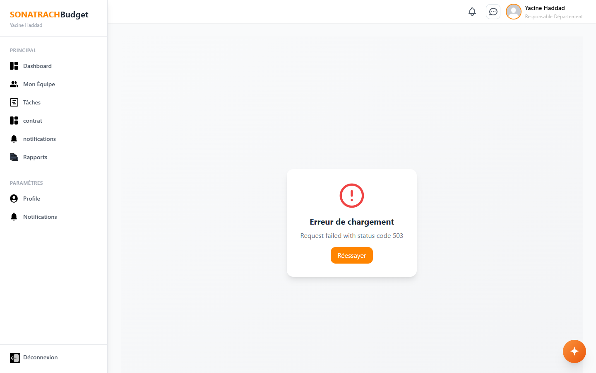

## 2. Welcome screen — "Point du jour" and role-based suggestions

The assistant is pinned at the top of the Messages panel. The daily briefing (*2 livraisons en retard · 1 brouillon à finaliser*) is computed in JavaScript from the contracts API — no AI call, so it is instant and exact. The suggested questions depend on the user's role.

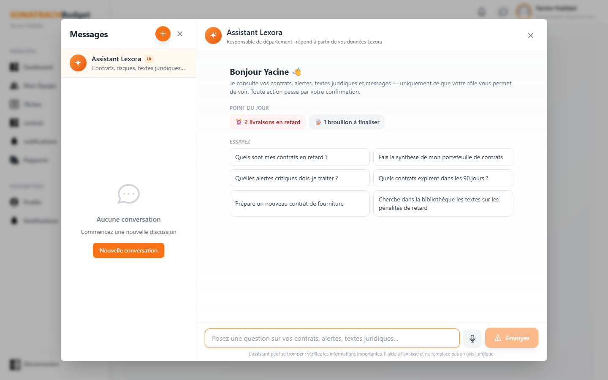

## 3. A question answered from live Lexora data

*« Quels sont mes contrats en retard ? »* → the model asks for the `rechercher_contrats` tool, the browser runs it with the user's own JWT (so the backend's scoping applies), and the answer comes back with clickable contract cards.

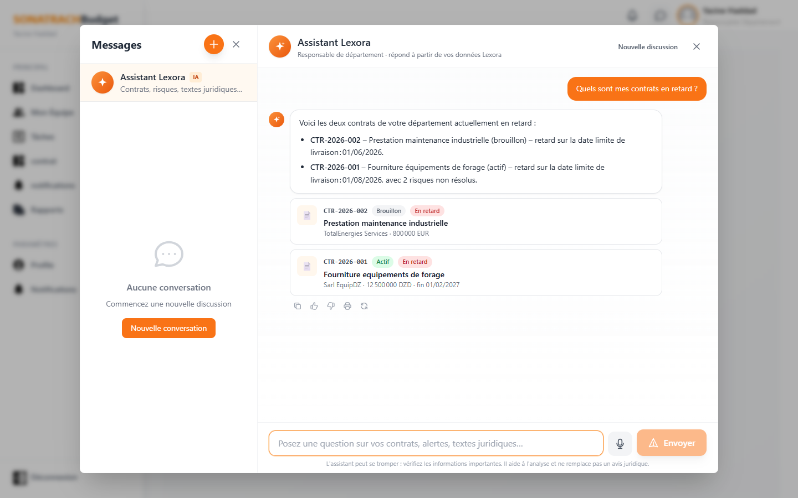

## 4. Contract detail — AI summary

Clicking a card opens the contract. The new **✨ Assistant IA** tab summarises the contract from its fields, metadata and detected risks, and flags what is missing (*conditions de paiement : non renseigné*).

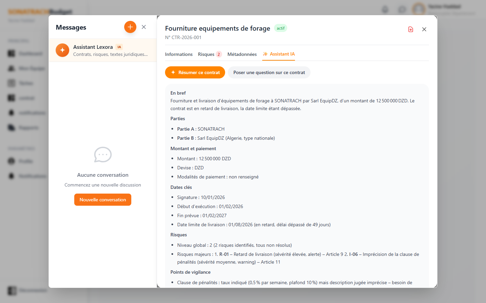

## 5. "Expliquer / Que faire ?" on a risk — with a proposed clause

Each detected risk gets a plain-language explanation, the possible consequence, recommended actions and a **corrected clause proposal** (values to confirm are left in `[brackets]`), ending with "Proposition à faire valider par un juriste".

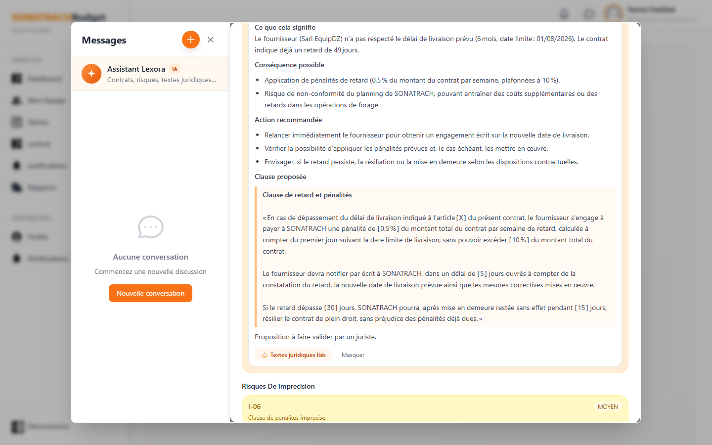

## 6. Portfolio synthesis

Totals, amounts per currency, delays and deadlines are **computed in JavaScript** over all the user's contracts (`statistiques_contrats`); the model only writes the narrative. The printer icon under an answer exports it to PDF.

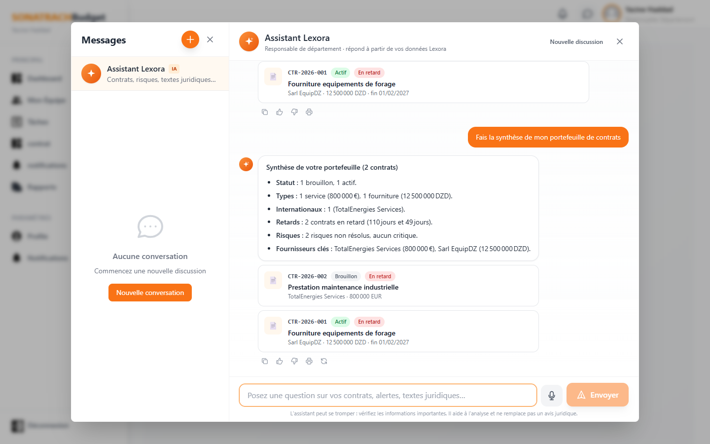

## 7. Actions always ask first

*« Envoie un message à Root Admin… »* → the assistant finds the user in the directory and drafts the message, but nothing is sent until the user clicks **Envoyer**. The text stays editable. (Cancelled in this session.) When the request was ambiguous — two administrators exist — the assistant asked which one instead of guessing.

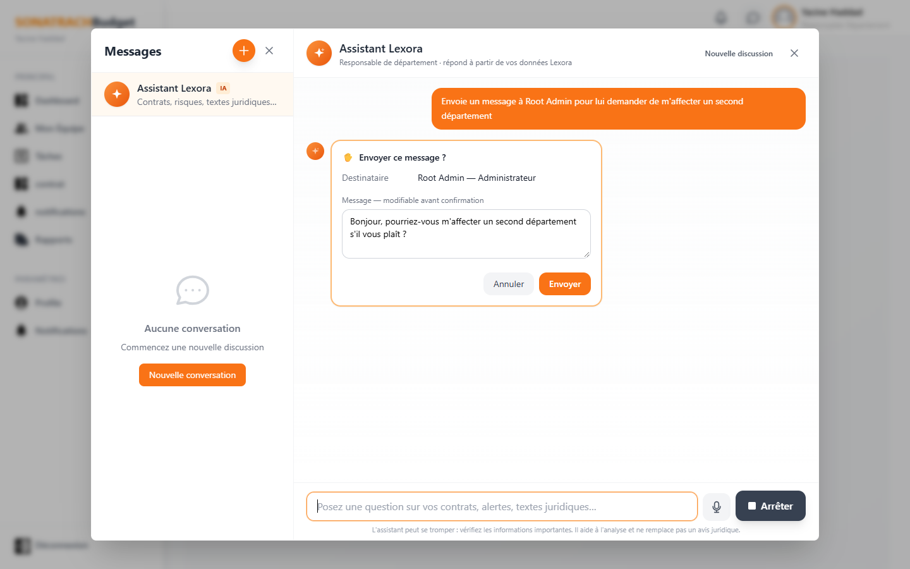

## 8. Pre-submission check of a draft

Submitting a contract is irreversible, so the draft can be reviewed first: missing end date, no penalty clause, no competent court, international contract without an applicable-law clause…

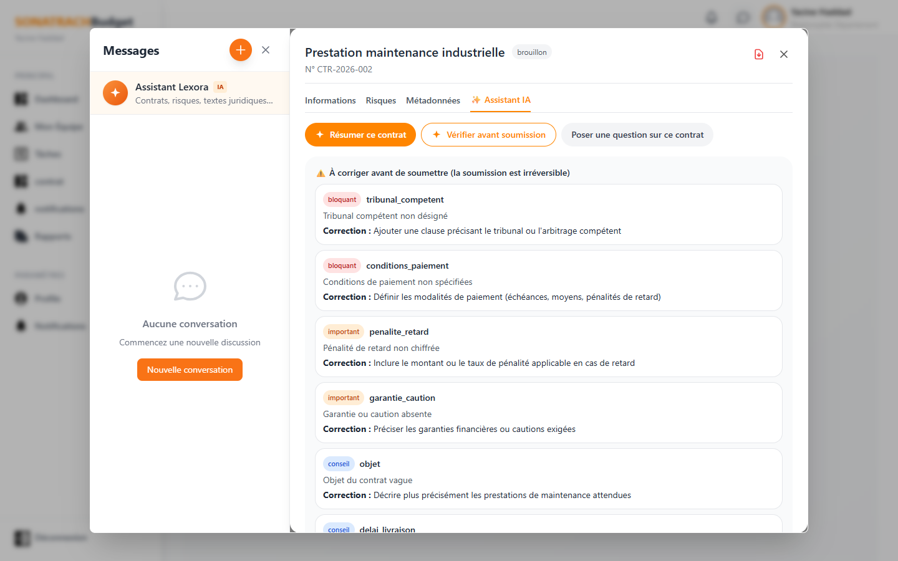

## 9. Creating a contract by conversation

*« Prépare un contrat de service avec Schlumberger Algérie… 4 000 000 USD »* → the **Nouveau Contrat** form opens pre-filled. Only what the user actually said is filled in (the dates stay empty — the assistant is not allowed to invent them), and nothing is saved until the user validates.

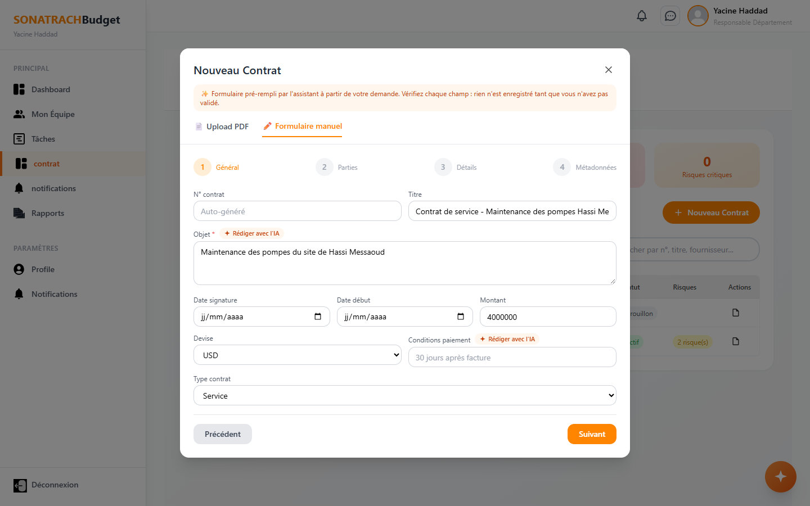

## 10. "Rédiger avec l'IA" inside the form

A few keywords in **Objet** become a precise, unambiguous clause; unknown values are left as `[…]`.

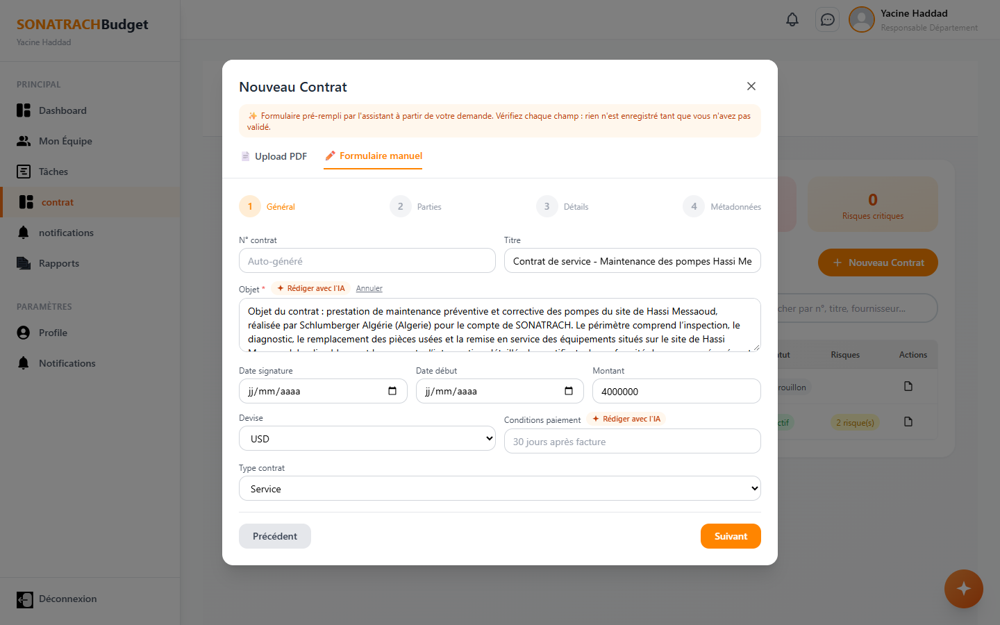

## 11. Honest failure handling

During this session the backend's Node services (`/bib`, `/notifications`, `/juridique`) were answering **503**. Asked about the legal library, the assistant says the service is unavailable instead of quoting laws from memory.

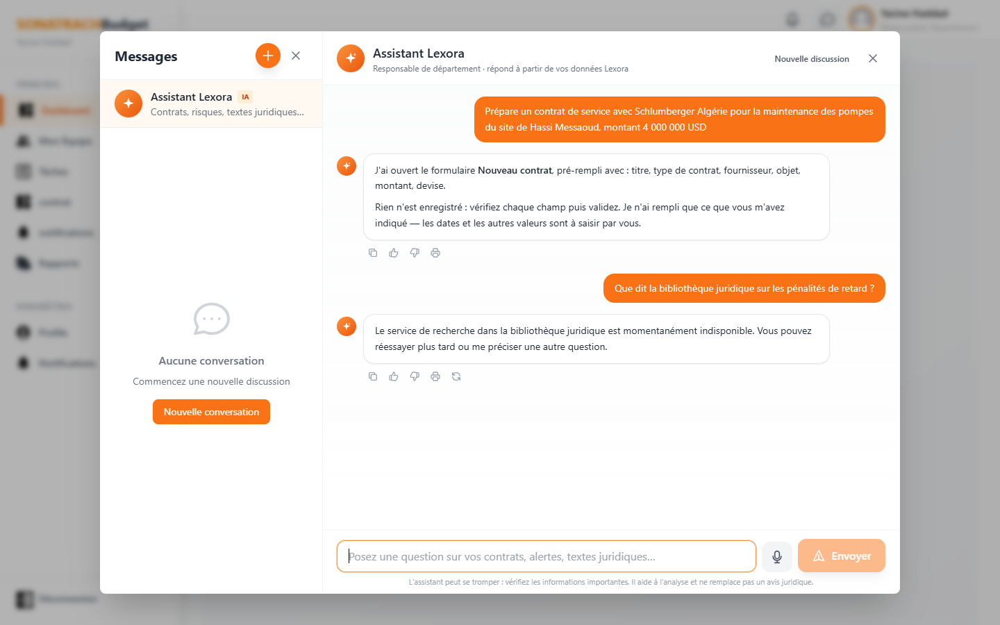

---

## Not pictured (backend services were down during the session)

These features are built and their AI side was tested directly against the proxy, but their screens need `/notifications` and `/bib`, which returned 503 at capture time:

- In conversations between people: **✨ rédiger / changer de ton / traduire**, **suggestions de réponse**, **Résumer la conversation**, **traduire un message reçu** (right-click), **`@lexora question`** for a private answer inside a conversation.
- Risk alerts page: **« Que faire ? »** on an alert, **« Mettre en forme avec l'IA »** for the resolution note.
- Legal library: **« Remplir la fiche avec l'IA »** when uploading a PDF, **« Résumer ce document »** and questions on a document's content.
- Voice dictation 🎙 (needs a microphone, not available in an automated browser).

## Reproducing

```bash
npm install
npm start                      # http://localhost:3000 — the AI proxy is mounted by src/setupProxy.js
```

`.env` must contain `AI_API_KEY=<Groq key>` (never prefixed with `REACT_APP_`). Log in with `rd@sonatrach.dz` / `Test1234!` and click the ✨ button.
